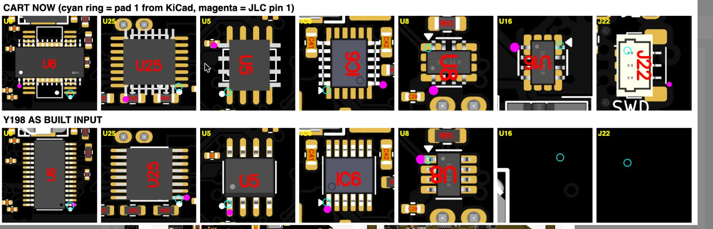
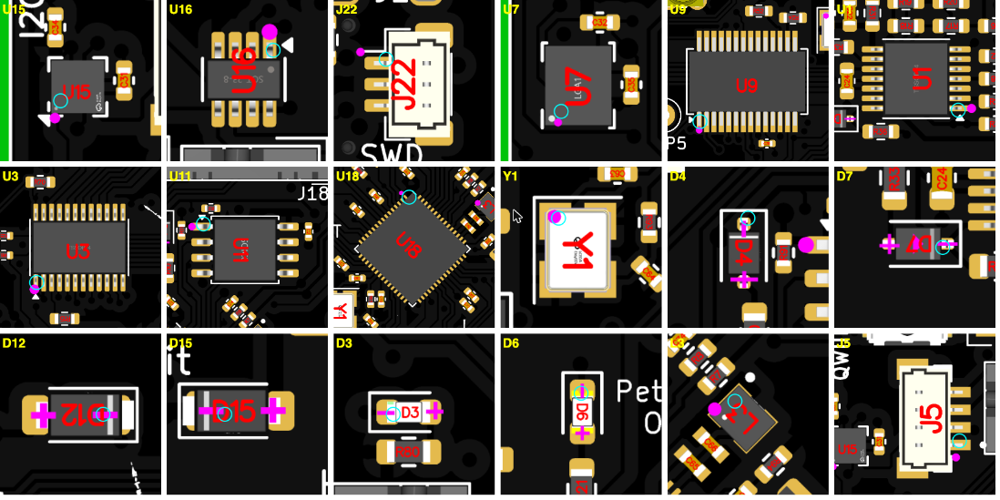
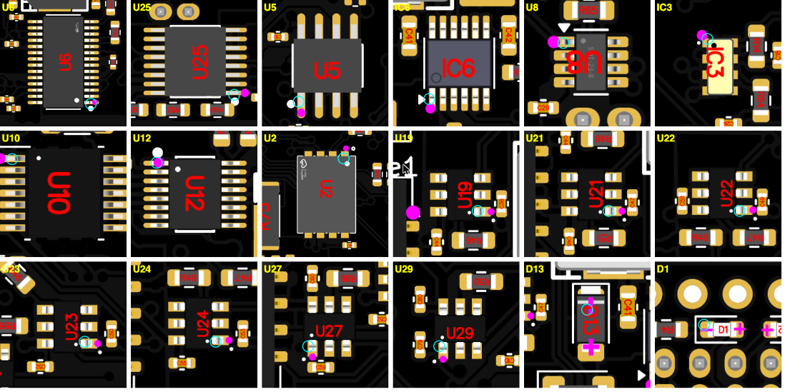

# V5e Rev2 placement rotations for the November 2026 reorder

The reorder of Y198 showed eight polarized parts away from pad 1 in JLC's placement preview. All eight were corrected in JLC's placement viewer on 2026-11-02, and the saved cart item was checked afterward.

| Ref | Part | Side | Applied in viewer | CPL was | CPL now |
|---|---|---|---|---|---|
| U5 | APS1604M | bottom | Rotate Left 90° | 270 | 0 |
| U6 | TPS4H160B | bottom | Rotate Left 90° | 0 | 90 |
| U25 | TPS2HB50A | bottom | Rotate Left 90° | 0 | 90 |
| IC6 | LT3652 | bottom | Rotate Right 90° | 90 | 0 |
| U8 | INA219 | bottom | Rotate Right 90° | 270 | 180 |
| U16 | INA219 | top | Rotate Right 90° | 180 | 90 |
| U15 | LIS2MDL | top | Rotate Right 90° | 90 | 0 |
| J22 | BM03B-SRSS | top | 180° | -90 | 90 |

U15 was also off in Y198's original placement. JLC's corrected placement for Y198 put its pin 1 at the silkscreen triangle, which matches this change.

## Evidence

Before, from the cart preview. The top row is the cart and the bottom row is Y198. The cyan ring is pad 1 from KiCad and magenta is JLC's pin 1. The Y198 cells for U16 and J22 are blank because of a crop error.

After, from the saved cart item.

## How the CPL values were derived

- The viewer shows no rotation numbers. The CPL values are the old values plus the rotation applied in the viewer.
- Bottom-side sign: positive CPL rotation is CCW in JLC's bottom view. U19 (CPL 90) and U27 (CPL 0) are the same part, both render correctly, and U27 sits 90° CW of U19.
- Top-side sign: positive CPL rotation is CCW, by JLC's convention. U15 and U16 depend on this.

## Open items

- This CPL file has not been uploaded to JLC. The cart item got its rotations from the viewer. Check all eight if this file is uploaded.
- The cause is unknown. The repo CPL had not changed since Y198, but the same parts rendered differently on the reorder.
